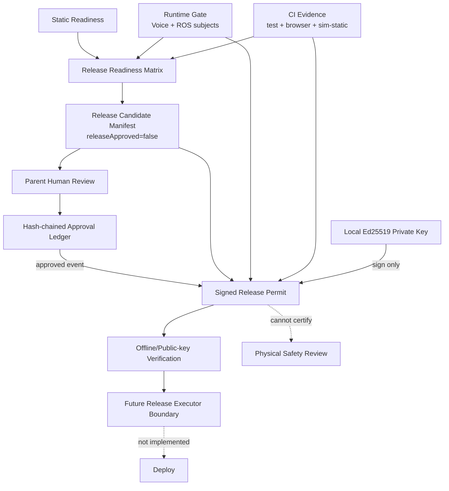
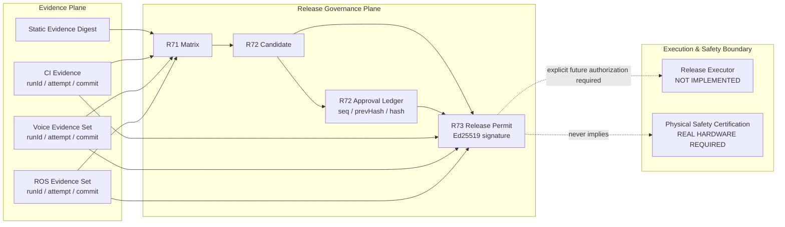

# R73：Signed Release Permit + Evidence Bundle

R73 的目标不是增加自动发布能力，而是把 R72 已冻结的 Candidate 与人工 Approval，再和同一 Commit 的 CI / Voice / ROS 运行主体绑定成一个 **Ed25519 签名的发布许可**。

## 不变量

- Candidate 仍然是只读候选，内部 `releaseApproved=false`。
- Approval Ledger 是唯一人工批准事实来源；Permit 不写回账本。
- Permit 中 `releaseApproved=true` 只表示“该 Permit 引用了一个有效 approved 事件”。
- `deployAuthorized=false`、`deployExecuted=false`、`physicalSafetyCertified=false` 固定为 false。
- 浏览器与服务端均没有 deploy / publish / upgrade API。
- Permit 必须绑定同一 Commit 的 CI、Voice、ROS subject。
- Candidate 冻结的 Runtime / CI SHA-256 必须与实际输入文件完全一致。
- Permit 必须使用 Ed25519 私钥签名；验证只需要公钥。
- 签名密钥文件不进入仓库、不进入 Permit、不进入日志。

## 最新发布治理设计图



## 最新架构图



## Permit 绑定字段

```text
alex.dev/release-permit/v1
├─ candidate
│  ├─ id
│  ├─ digestSha256
│  └─ commitSha
├─ approval
│  ├─ eventSeq
│  ├─ eventHash
│  └─ acknowledgements
├─ subjects
│  ├─ ci:    runId + attempt + commitSha
│  ├─ voice: runId + attempt + commitSha
│  └─ ros:   runId + attempt + commitSha
├─ evidenceBundle
│  ├─ candidateSha256
│  ├─ approvalLedgerSha256
│  ├─ runtimeGateSha256
│  ├─ ciEvidenceSha256
│  └─ sourceEvidence digests
├─ signature
│  ├─ algorithm = Ed25519
│  ├─ keyId
│  └─ valueBase64
└─ hard safety flags
   ├─ deployAuthorized=false
   ├─ deployExecuted=false
   └─ physicalSafetyCertified=false
```

## CLI

签发：

```bash
npm run release:permit -- sign \
  candidate.json \
  release-approvals.json \
  runtime.json \
  ci.json \
  release-private-key.pem \
  local-release-key-v1 \
  permit.json
```

校验：

```bash
npm run release:permit -- verify \
  permit.json \
  release-public-key.pem \
  <expected-commit-sha>
```

私钥必须保存在仓库外的受限路径；R73 不提供生成、上传或托管私钥的 HTTP API。

## R73 之后仍需真实闭环

1. 实际 dispatch R68 ROS/Gazebo self-hosted workflow，并保存可复核的 Run / Artifact。
2. 实际 dispatch R69 Voice Provider workflow，消费真实 Provider。
3. 真实麦克风 → ASR → LLM → TTS → 扬声器声学链路。
4. 隔离环境中的真实备份恢复与回滚演练。
5. 真实家庭/儿童 Pilot。
6. 实体机器人阶段的急停、限速、碰撞、夹伤、儿童接近等物理安全验证。
7. Actions 第三方 action 从浮动 `@v4` 改为 immutable commit SHA。
8. 若未来实现 Release Executor，必须单独设计“Permit 验签 + 二次执行授权”，不能复用 `releaseApproved` 直接执行。
