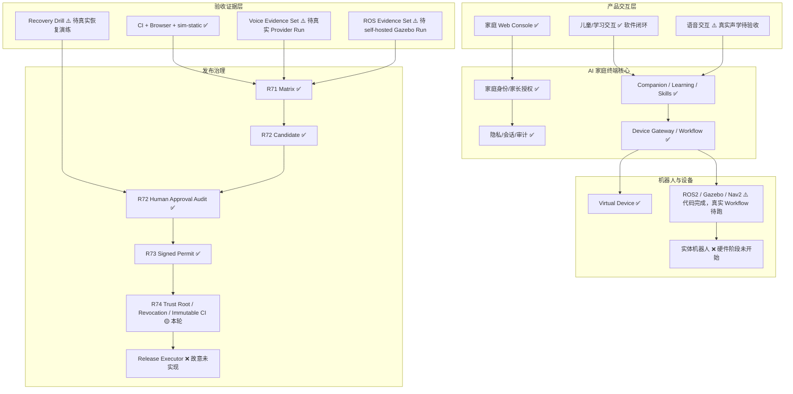

# R74：Release Trust Root + Permit Revocation + Immutable CI Provenance

## 本轮目的

R73 已能签发 Ed25519 Permit，但 verifier 仍可由调用方直接传入任意 signer 公钥。R74 增加真正的信任链：

```text
Pinned Root Public Key
        ↓
Root-signed Trust Policy
        ↓
Active Permit Signer Key
        ↓
R73 Signed Release Permit
        ↓
Root-signed Revocation Manifest
        ↓
Policy Verification Result
```

任何一步失败都 fail closed，且最终结果仍固定：

```ini
deployAuthorized=false
physicalSafetyCertified=false
```

## 产品架构与进度



## R74 安全边界

1. Root 私钥不进入仓库、HTTP API、日志。
2. Trust Policy 由 Root Ed25519 签名，包含 Permit signer 的 keyId、公钥、notBefore 与 revoked 状态。
3. Permit verifier 必须从 Trust Policy 解析 signer，不能直接信任调用方任意 signer 公钥。
4. Permit Revocation Manifest 同样由 Root 签名，并带 sequence；调用方可保存最小 sequence 防止回滚旧撤销清单。
5. GitHub 官方 Actions 全部固定到 40 位 commit SHA。
6. 三个关键 workflow 均计算 SHA-256 provenance；该检查只证明源码不可漂移，不冒充 ROS/Voice runtime。
7. R74 仍没有部署、升级、回滚执行能力。

## 仍未闭环

- 真实 Voice Provider workflow dispatch。
- 真实 ROS/Gazebo self-hosted workflow dispatch。
- 真实麦克风/扬声器声学链。
- 离线备份恢复与回滚演练。
- 真实家庭/儿童 Pilot。
- 实体硬件安全认证。
- Release Executor：在上述真实验收前不应实现。
